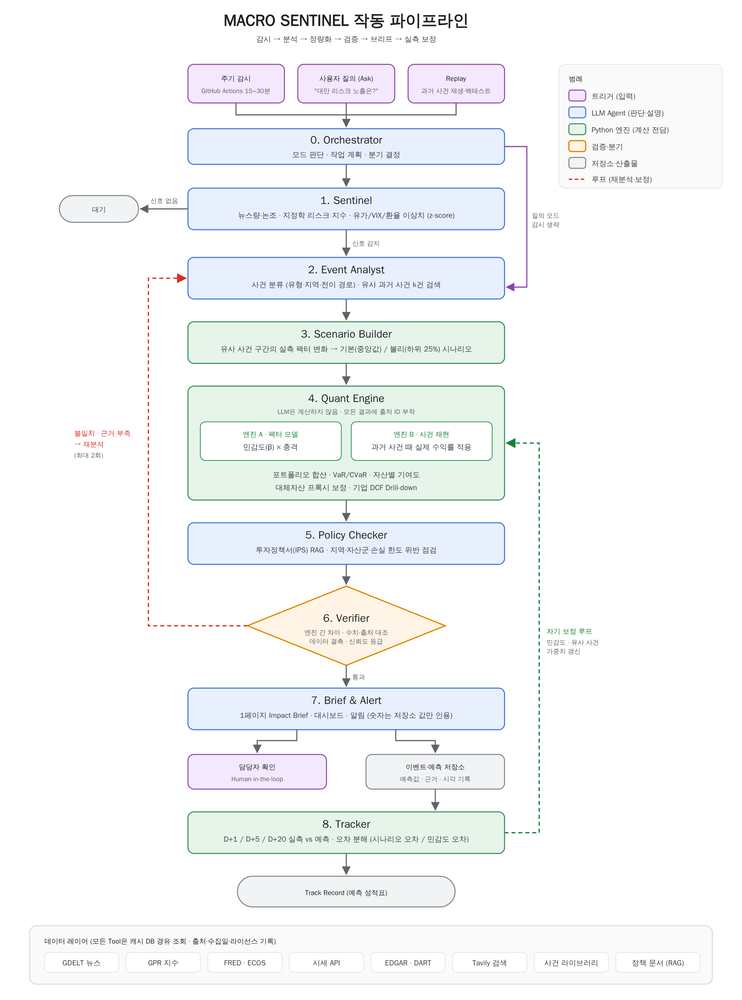
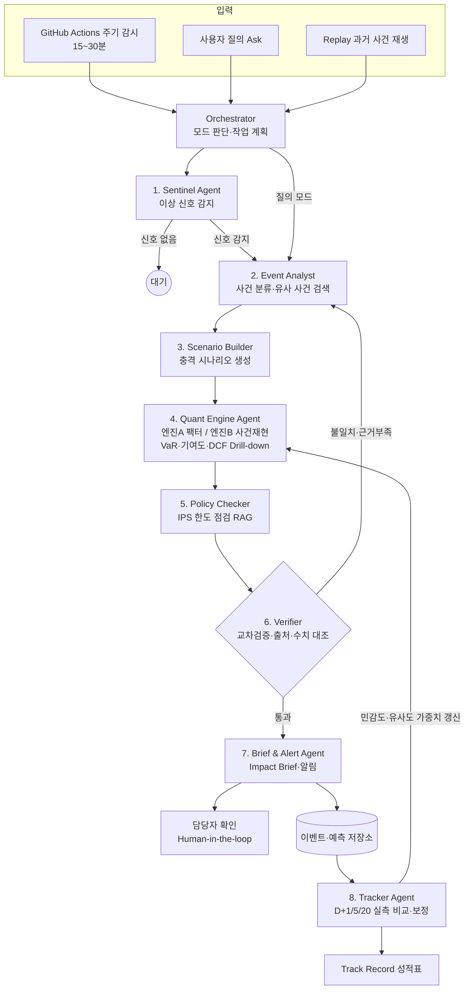

# MACRO SENTINEL (가칭)
### 지정학·매크로 충격을 감시하고, 포트폴리오 영향을 추정한 뒤 실측치로 검증하는 관찰형 AI Agent

> **[작성 메모 - 제출 시 삭제]**
> - 필수 목차 7개 유지. 페이지 배분 목표: Summary 1 / 문제 정의 1.5 / 서비스 제안 1.5 / Agent 구성 2.5 / 데이터 1 / MVP 1.5 / 기대효과 1 = 10p
> - `[확인]` = 제출 전 최신 수치/약관 확인 필요, `[기입]` = 프로토타입 결과로 채울 자리
> - 본 문서의 모든 수치 예시는 설명용 가상값이며, 실측 결과는 백테스트 후 `[기입]` 자리에만 넣을 것

---

## 1. Summary

| 구분 | 내용 |
|---|---|
| **한 줄 정의** | 지정학·매크로 사건을 준실시간으로 감지하고, 사용자 포트폴리오의 예상 손익을 **과거 실측 데이터 기반**으로 산출한 뒤, 사건 이후 **실제 결과와 비교해 스스로 보정**하는 관찰형 AI Agent |
| **대상 사용자** | 국부펀드(KIC), 연기금·공제회, 자산운용사, 보험사 등 해외자산을 보유한 기관투자자의 리스크관리·운용 조직 |
| **해결 문제** | ① 사건 감지 지연과 정보 과부하 ② 충격 크기에 대한 정량 근거 부족 ③ 예측의 사후 검증 부재 ④ 대체자산·개별 투자건 영향 분석의 별도 수작업 |
| **핵심 기능** | 상시 감시(Monitor) → 사건 분석(Analyze) → 영향 추정(Impact) → 교차 검증(Verify) → 브리프·알림(Brief) → 실측 추적·보정(Track & Calibrate) + 질의응답(Ask) + 과거 사건 재현(Replay) |
| **차별점** | ① LLM은 판단·설명만, **모든 숫자는 검증된 Python 정량 엔진이 산출** ② 독립된 두 엔진(팩터 모델 / 과거 사건 재현)의 **교차 검증 루프** ③ **예측 → 실측 → 보정** 자기학습 루프와 공개 성적표(Track Record) |
| **Agent 구성** | LangGraph 기반 8개 전문 Agent, 13개 Tool, 조건 분기 및 재분석 루프, Human-in-the-loop |
| **데이터** | GDELT, GPR Index, FRED, 한국은행 ECOS, SEC EDGAR, OpenDART, 시세 API, 공개 정책문서 (전부 공개·적법 데이터) |
| **MVP** | Streamlit 웹앱 + GitHub Actions 주기 감시 + 백테스트 리포트, 운영비 월 3만 원 이내 목표 |
| **목표 지표** | 사건 감지 → 브리프 생성 30분 이내, 과거 사건 백테스트 방향 적중률·오차(MAE) 공개 `[기입]` |

---

## 2. 문제 정의

### 2.1 배경
- 국내 대형 기관투자자의 자산 상당 부분이 해외에 투자되어 있음
  - **KIC**: 총운용자산 **2,320억 달러**(2025년 말, 역대 최대). 정부·한국은행 위탁 자산을 **전액 해외에 투자**하며, 전통자산 78.1% / 대체자산 21.9% (출처: KIC 홈페이지 투자운용현황)
  - **국민연금**: 기금 1,684.2조 원 중 **해외투자 56.6%(951.2조 원)**, 2026년 7월 말 기준 (출처: 국민연금기금운용본부 포트폴리오 현황)
  - 해외 지정학·매크로 사건이 국내 기관 자산에 구조적으로 직접 전이되는 구조임
- 최근 수년간 전쟁, 무역분쟁, 중동 분쟁, 금융시스템 사고 등 **예측 불가능한 충격이 잦아지고 시장 전이 속도가 빨라짐**
  - 예: 러시아-우크라이나 전쟁(2022.02), SVB 사태(2023.03), 이스라엘-하마스 전쟁(2023.10), 엔 캐리 청산(2024.08), 미국 상호관세 발표(2025.04)

### 2.2 현업 프로세스와 병목 (사건 발생 시)

| 단계 | 현재 방식 | 병목 |
|---|---|---|
| ① 감지 | 뉴스·단말기 수동 확인 | 정보 과부하, 야간·주말 공백, 감지 지연 |
| ② 판단 | "이 사건이 우리 자산에 영향이 있나?" 담당자 경험에 의존 | 사람마다 판단이 다르고 근거 기록이 남지 않음 |
| ③ 정량화 | 스프레드시트로 시나리오 충격값을 가정해 스트레스 테스트 | **충격 크기(예: 유가 +20%) 가정의 근거가 약함**, 수 시간~수일 소요 |
| ④ 보고 | 보고서 수작업 작성 | 사건이 진행되는 동안 보고가 늦음 |
| ⑤ 사후 검증 | 거의 없음 | **예측이 맞았는지 체계적으로 기록·학습하지 않음** |

- 대체자산(사모, 부동산, 인프라)과 개별 기업 투자건은 시가 정보가 없어 영향 분석이 별도 수작업으로 이뤄짐

### 2.3 기존 접근의 한계

| 구분 | 한계 |
|---|---|
| 상용 리스크 시스템 | 고가, 사전 정의된 범용 시나리오 중심. **사건 발생 → 시나리오 생성**이 자동화되지 않음 |
| 공개 지정학 리스크 지표·대시보드 | 지수 수준 정보로, 사용자 포트폴리오와 연결되지 않음 |
| 일반 LLM 챗봇 | 수치 환각, 출처 불명, 예측의 사후 검증 기능 없음 |

### 2.4 문제 정의
> **"기관투자자는 지정학·매크로 사건이 발생했을 때, 자기 포트폴리오에 미칠 영향을 *빠르고, 근거 있게, 검증 가능하게* 추정할 수단이 없다."**

---

## 3. 서비스 제안

### 3.1 서비스 콘셉트
**MACRO SENTINEL**은 24시간 시장과 뉴스를 관찰하다가 의미 있는 사건이 감지되면, 스스로 유사한 과거 사건을 찾아 충격 시나리오를 만들고, 포트폴리오 영향을 계산·검증해 브리프로 알린 뒤, 이후 실제 시장 결과를 추적해 자신의 예측 정확도를 기록하고 개선하는 AI Agent임.

### 3.2 "포트폴리오 영향"의 정의
- **포트폴리오** = 기관이 보유한 자산들의 묶음과 각 비중 (예: 글로벌 주식 40%, 채권 35%, 대체자산 25%)
- **포트폴리오 영향** = 특정 사건으로 시장 변수(유가, 달러, 금리, 변동성 등)가 움직였을 때 **포트폴리오 전체 가치가 얼마나 변하는지, 그리고 어느 자산이 그 변화를 주도하는지**를 수치로 나타낸 것

**[예시 - 설명용 가상값]** 운용자산 10조 원, 중동 무력충돌 감지

| 단계 | 내용 |
|---|---|
| 1. 충격 시나리오 | 유사 과거 사건 5건의 실측 중앙값 → 유가 +9%, VIX +6pt, 달러 +1.2%, 미 10년물 -15bp (5영업일 기준) |
| 2. 자산별 민감도 | 과거 3년 데이터 회귀 → 예: 신흥국 주식은 유가 1% 상승 시 -0.12% |
| 3. 자산별 영향 | 민감도 × 충격 → 미국 주식 -2.1%, 신흥국 주식 -3.4%, 국채 +0.8%, 금 +2.5% … |
| 4. 포트폴리오 합산 | Σ(비중 × 자산별 영향) = **-1.6% (약 -1,600억 원)**, 불리한 시나리오(하위 25%) -2.9% |
| 5. 기여도 분해 | 손실의 58%는 신흥국 주식, 21%는 에너지 수입국 통화 익스포저에서 발생 |
| 6. 실측 검증 | 5영업일 후 실제 -1.3% → 오차 0.3%p 기록, 오차를 시나리오 오차와 민감도 오차로 분해해 보정 |

### 3.3 핵심 기능

| 모드 | 기능 | 산출물 |
|---|---|---|
| ① Monitor | 뉴스량·논조, 지정학 리스크 지수, 시장 변수의 이상 신호를 주기적으로 감시 | 이상 신호 이벤트 |
| ② Impact | 유사 과거 사건 기반 시나리오 생성 → 포트폴리오 영향 산출 (기본·불리 시나리오, 기간 D+1/D+5/D+20) | 손익 추정치, 기여도 |
| ③ Drill-down | 대체자산 프록시 분석, 개별 기업 투자건의 재무(매출원가·할인율) 충격 및 DCF 민감도 | 기업 가치 범위, 민감도 차트 |
| ④ Policy Check | 사용자 투자정책서(IPS)의 한도(지역·자산군·손실 한도) 위반 가능성 점검 | 한도 경고 |
| ⑤ Brief & Alert | 1페이지 Impact Brief, 대시보드, 알림 | 브리프(PDF), 알림 |
| ⑥ Track & Calibrate | 사건 후 실측 수익률과 예측 비교, 오차 분해, 모델 보정 | 성적표(Track Record) |
| ⑦ Ask | "대만 해협 리스크에 우리 노출은?" 같은 자연어 질의 → Agent가 필요한 도구를 골라 분석 | 답변 + 근거 수치 |
| ⑧ Replay | 과거 사건을 실시간처럼 재생해 Agent 동작과 정확도를 검증 | 시연·백테스트 |

### 3.4 사용자 시나리오 (연기금 리스크관리팀)
```
02:40  해외 무력충돌 보도 급증 → Sentinel이 뉴스량 z-score 4.1, 유가 선물 +5% 감지
02:42  Event Analyst: "중동 / 군사충돌 / 에너지 공급 경로" 분류, 유사 사건 5건 선정
02:50  Quant Engine: 포트폴리오 -1.6% (불리 -2.9%) 추정, 두 엔진 오차 0.4%p로 검증 통과
02:55  Policy Check: 신흥국 주식 손실 한도 근접 경고
03:00  담당자에게 1페이지 Impact Brief 알림 → 출근 전 대응안 검토 가능
D+5    Tracker: 실측 -1.3%, 오차 기록, 유가 민감도 보정
```

### 3.5 범용 기관투자자 지원
- 포트폴리오 입력: CSV 업로드(자산, 비중) 또는 프리셋 선택 (국부펀드형, 연기금형, 60/40형) - 프리셋은 공개 자산배분을 ETF·지수 프록시로 재현
  - 국부펀드형(KIC 2025년 말 공개 비중): 주식 41.6%, 채권 32.8%, 사모주식 7.6%, 부동산 5.0%, 인프라 4.5%, 헤지펀드 2.6%, 사모채권 2.0%, 기타 3.9%
  - 연기금형(국민연금 2026년 7월 말 공개 비중): 해외주식 37.0%, 국내주식 24.9%, 국내채권 16.8%, 대체투자 14.8%, 해외채권 6.1% 등
- 대체자산: 상장 프록시 매핑(사모주식 → 소형주 지수, 부동산 → 리츠, 인프라 → 상장 인프라 지수) + 평활화 보정
- 투자정책서: 사용자 IPS 문서 업로드 시 RAG로 한도 조항 추출 (데모는 공개 정책문서 기반 예시 IPS 사용)

---

## 4. AI Agent 구성

### 4.1 전체 아키텍처



<details><summary>Mermaid 버전</summary>


</details>

### 4.2 Agent 역할 정의

| # | Agent | 역할 | 주요 Tool | 출력 | 모델 등급 |
|---|---|---|---|---|---|
| 0 | Orchestrator | 입력 유형(감시/질의/재생) 판단, 작업 계획 수립, 분기 결정 | - | 실행 계획 | 상위 |
| 1 | Sentinel | 뉴스량·논조, GPR, 시장 변수의 이상치 탐지, 중복 사건 병합 | `gdelt_query`, `market_snapshot`, `anomaly_detect` | 이벤트 후보 + 신호 강도 | 경량 |
| 2 | Event Analyst | 사건 유형·지역·전이 경로 분류, 유사 과거 사건 검색·선정 | `news_search`, `event_library_search` | 사건 카드 + 유사 사건 k건 | 상위 |
| 3 | Scenario Builder | 유사 사건 구간의 팩터 실측 변화로 기본·불리 시나리오 생성 | `factor_history`, `scenario_from_analogs` | 팩터 충격 벡터 | 경량 |
| 4 | Quant Engine | 두 엔진으로 영향 계산, VaR/CVaR, 기여도, 대체자산 보정, 기업 Drill-down | `estimate_betas`, `factor_stress`, `analog_replay`, `risk_metrics`, `dcf_sensitivity` | 수치 결과 (출처 ID 부착) | 경량 (계산은 Python) |
| 5 | Policy Checker | 투자정책서 한도 조항 검색, 추정 손익과 대조 | `ips_rag_search`, `limit_check` | 한도 경고 | 경량 |
| 6 | Verifier | 엔진 간 차이, 데이터 결측, 수치-출처 일치, 논리 오류 점검 → 재분석 지시 | `cross_check`, `fact_audit` | 통과/재분석 + 신뢰도 등급 | 상위 |
| 7 | Brief & Alert | 1페이지 브리프, 차트, 알림 메시지 생성 (수치는 저장된 결과만 인용) | `render_brief`, `send_alert` | Impact Brief | 상위 |
| 8 | Tracker | 사건 후 실측 비교, 오차를 시나리오 오차/민감도 오차로 분해, 보정 | `realized_returns`, `calibrate` | 성적표, 보정 파라미터 | 경량 |

- 모델 등급: 경량 = 저비용 모델(예: Claude Haiku 5.5), 상위 = 고성능 모델(예: Claude Sonnet 5.5). 모델은 설정 파일로 교체 가능하게 설계

### 4.3 Tool 명세

| Tool | 기능 | 구현 |
|---|---|---|
| `gdelt_query` | 키워드·국가별 뉴스량, 논조(tone) 시계열 | GDELT DOC 2.0 API |
| `news_search` | 사건 관련 기사 제목·출처 검색 | Tavily Search API |
| `market_snapshot` | 유가, VIX, 달러, 금리, 환율 등 최신값 | 시세 API + FRED |
| `anomaly_detect` | 롤링 z-score, 변화점 탐지 | Python (numpy, ruptures) |
| `event_library_search` | 과거 사건 라이브러리 유사도 검색 | 임베딩 + 메타데이터 필터 (ChromaDB) |
| `factor_history` | 팩터 시계열 조회 | 캐시 DB |
| `scenario_from_analogs` | 유사 사건 구간 팩터 변화의 중앙값·하위 25% | Python |
| `estimate_betas` | 자산별 팩터 민감도 회귀 (사건 이전 데이터만 사용) | statsmodels, Ridge |
| `factor_stress` / `analog_replay` | 엔진 A / 엔진 B 영향 계산 | Python |
| `risk_metrics` | VaR, CVaR, 기여도 분해 | Python |
| `dcf_sensitivity` | 매출·원가·할인율 충격 반영 DCF 범위 | Python + EDGAR/DART 재무 |
| `ips_rag_search` / `limit_check` | 정책서 조항 검색, 한도 대조 | ChromaDB + Python |
| `cross_check` / `fact_audit` | 엔진 간 차이 판정, 브리프 내 수치와 결과 저장소 대조 | Python |

### 4.4 정량 엔진 방법론 (LLM은 계산하지 않음)
- **팩터 집합**: 유가(Brent), 달러지수, 미 10년물 금리, 하이일드 스프레드, VIX, 금, 원/달러, GPR 지수
- **민감도(β)**: 주간 수익률 3년 롤링 회귀, Ridge 수축으로 과적합 방지. **백테스트 시 사건 이전 데이터만 사용**해 미래 정보 누수 차단
- **시나리오**: 유사 사건 k건의 [사건일, 사건일+h] 구간 팩터 실측 변화 → 중앙값(기본) / 하위 25%(불리)
- **엔진 A (팩터 모델)**: 자산 영향 = Σ(β × 팩터 충격)
- **엔진 B (사건 재현)**: 유사 사건 구간에서 해당 자산(또는 프록시)의 실제 수익률을 그대로 적용
- **포트폴리오 영향**: Σ(비중 × 자산 영향), 자산별 기여도, 스트레스 구간 가중 VaR/CVaR
- **교차 검증**: 두 엔진의 차이가 임계값 초과 시 Verifier가 유사 사건 재선정 또는 구간 변경을 지시 (최대 2회 루프)
- **대체자산**: 상장 프록시 + Geltner 평활화 보정
- **기업 Drill-down**: 과거 분기 재무로 추정한 탄력성(예: 매출총이익률의 유가 민감도)으로 원가·할인율 충격 반영 → DCF 가치 범위와 민감도 차트. LLM은 Peer 선정과 설명만 담당

### 4.5 신뢰성 장치
- **수치 출처 강제**: 모든 수치는 Tool 결과 저장소에 출처 ID와 함께 기록되고, 브리프는 출처 ID로만 숫자를 인용. `fact_audit`가 브리프 내 모든 숫자를 저장소와 대조해 불일치 시 재생성
- **신뢰도 등급**: 유사 사건 수, 엔진 간 차이, 데이터 결측률로 A/B/C 등급 표기
- **인용**: 뉴스 원문 링크, 데이터 출처·조회 시각 표기
- **Human-in-the-loop**: 외부 발송 전 담당자 확인, 감지 임계값 사용자 설정
- **고지**: "투자 판단 보조 도구이며 통계적 연관성 기반 추정임" 명시

---

## 5. 데이터 활용 계획

### 5.1 데이터 소스

| 데이터 | 출처 | 주기 | 접근 | 이용 조건 | 용도 |
|---|---|---|---|---|---|
| 글로벌 뉴스량·논조 | GDELT Project | 15분 | 무료 API | 무제한·무제약 이용 표방, 인용 표기 `[확인: gdeltproject.org/about 원문]` | 사건 감지 |
| 기사 검색 | Tavily Search API | 수시 | 무료 할당량 | 약관 `[확인]` | 사건 맥락·인용 |
| 지정학 리스크 지수 | Caldara & Iacoviello GPR Index (월간 GPR, 일간 AI-GPR) | 일·월 (갱신 지연 있음) | 무료 다운로드 | 인용 + 다운로드일 명시 | 팩터·백테스트 (실시간 감지는 GDELT 담당) |
| 미국 매크로·시장 지표 | FRED (St. Louis Fed) | 일·월 | 무료 API 키 | 출처 표기, 시리즈별 저작권 고지 유지, **AI·ML 개발/학습 이용 금지 조항** 있음 → 원시 데이터는 Python 계산에만 사용, LLM 학습·대량 다운로드 금지 | 팩터 |
| 국내 매크로·환율 | 한국은행 ECOS | 일·월 | 무료 API 키 | 공공데이터 | 팩터 |
| 자산 가격 | 시세 API (Tiingo/Alpha Vantage 등) + 초기 스냅샷 | 일 | 무료 tier | 비상업 이용 조건 `[확인]` | 민감도·실측 |
| 미국 기업 재무 | SEC EDGAR | 분기 | 무료 (User-Agent 필수) | 공공 | Drill-down |
| 국내 기업 재무 | OpenDART | 분기 | 무료 API 키 | 공공 | Drill-down |
| 정책 문서 | 한국투자공사법, KIC 연차보고서, 공개 기금운용지침 | 연 | 공개 | 공공·공개 | IPS 예시, 프리셋 |

### 5.2 과거 사건 라이브러리 (백테스트·유사 사건 검색용, 15~20건)

| 날짜 | 사건 | 유형 |
|---|---|---|
| 2016-06-23 | 브렉시트 국민투표 | 정치 |
| 2019-05-05 | 미중 관세 인상 예고 | 무역 |
| 2019-09-14 | 사우디 아브카이크 석유시설 피격 | 에너지·군사 |
| 2020-01-03 | 솔레이마니 사살 | 군사 |
| 2020-03-11 | WHO 팬데믹 선언 | 보건 |
| 2022-02-24 | 러시아 우크라이나 침공 | 전쟁 |
| 2023-03-10 | SVB 파산 | 금융시스템 |
| 2023-10-07 | 하마스 이스라엘 공격 | 군사 |
| 2023-12 | 홍해 후티 반군 선박 공격 확대 | 공급망 |
| 2024-04-13 | 이란 이스라엘 공습 | 군사 |
| 2024-08-05 | 엔 캐리 트레이드 청산 | 금융 |
| 2025-04-02 | 미국 상호관세 발표 | 무역 |
| 2025-06-13 | 이스라엘 이란 공습 | 군사 |
| … | `[추가 선정]` | |

- 각 사건: 날짜, 유형, 지역, 전이 경로, 요약을 구조화하고 임베딩해 검색

### 5.3 수집·전처리
```
수집(API) → 원본 저장(raw, 조회시각 기록) → 정제(휴일 정렬, 결측 보간, 통화 환산, 수익률 변환)
→ 피처(z-score, 팩터 수익률) → 캐시 DB(SQLite/Supabase) → Agent Tool에서 조회
```
- 모든 데이터는 `data_manifest.yaml`에 출처, 수집일, 라이선스, 전처리 내역 기록 (공모전 실증 요구 대응)
- API 응답 캐싱으로 호출량·비용 절감, 장애 시 마지막 스냅샷으로 대체
- 개인정보 미사용

---

## 6. MVP 개발 계획

### 6.1 MVP 범위 (우선순위)

| 우선순위 | 기능 |
|---|---|
| P0 (필수) | 데이터 수집·캐시, 정량 엔진 A/B, 사건 라이브러리, Replay 모드, LangGraph 파이프라인(감지→분석→시나리오→계산→검증→브리프), Streamlit 대시보드, 백테스트 리포트 |
| P1 | 주기 감시(GitHub Actions), Tracker 실측 비교·보정, Ask 질의 모드, 포트폴리오 CSV 업로드 |
| P2 | Policy Check(IPS RAG), 기업 DCF Drill-down, 대체자산 보정, 브리프 PDF 내보내기, 알림 |

### 6.2 기술 스택

| 계층 | 기술 |
|---|---|
| Agent | LangGraph (StateGraph, 조건 분기, 루프), Claude API |
| 정량 | pandas, numpy, statsmodels, scikit-learn, ruptures |
| 검색 | ChromaDB (사건 라이브러리, 정책 문서) |
| 저장 | SQLite (로컬) / Supabase 무료 플랜 (배포) |
| 스케줄링 | GitHub Actions cron (감시 루프) |
| UI·배포 | Streamlit + Streamlit Community Cloud |
| 시각화 | Plotly |
| 품질 | pytest (정량 함수 단위 테스트), 백테스트 스크립트 |

### 6.3 배포 구조
```
GitHub Actions (15~30분 cron) ──> 감시·분석 파이프라인 실행 ──> DB 저장
                                                              │
사용자 ──> Streamlit 앱 ──> DB 조회 (대시보드, 브리프, 성적표) ┘
                    └──> Ask / Replay 요청 시 파이프라인 즉시 실행
```
- Streamlit Community Cloud는 유휴 시 절전되므로 상시 감시는 GitHub Actions가 담당

### 6.4 일정

| 기간 | 작업 |
|---|---|
| 10/16 ~ 10/26 | 데이터 수집·캐시, 사건 라이브러리, 정량 엔진 A/B, 초기 백테스트 |
| 10/27 ~ 11/09 | 기획서 작성, 동작 화면·초기 백테스트 결과 반영 |
| **11/12** | **예선 제출** |
| 11/13 ~ 11/30 | LangGraph 파이프라인, Verifier 루프, Replay, Streamlit |
| 12/01 ~ 12/10 | Tracker, Ask, 주기 감시, P2 기능 |
| 12/11 ~ 12/21 | 전체 백테스트, 발표 PDF, 시연 영상, README |
| **12/22** | **본선 제출** |

### 6.5 비용 (목표 월 3만 원 이내)

| 항목 | 비용 |
|---|---|
| 데이터 API | 0원 (무료 tier) |
| 호스팅·스케줄러·DB | 0원 (Streamlit Cloud, GitHub Actions, Supabase 무료) |
| LLM API | 경량/상위 모델 분리, 응답 캐싱, 신호 없을 때 LLM 미호출로 최소화 `[기입: 실측 비용]` |

### 6.6 리스크와 대응

| 리스크 | 대응 |
|---|---|
| 시연 중 실제 사건 부재 | Replay 모드로 과거 사건 재생 |
| 무료 API 호출 제한·차단 | 캐시 + 스냅샷 대체, 호출 간격 조절 |
| 소수 사건으로 인한 통계적 한계 | 신뢰도 등급 표기, 두 엔진 교차 검증, 불리 시나리오 병기 |
| LLM 수치 환각 | 계산은 Python 전담, `fact_audit` 수치 대조 |
| 개인 개발 일정 | P0 → P1 → P2 순 개발, 단위 테스트로 회귀 방지 |

### 6.7 검증 계획 (백테스트 프로토콜)
- 사건 라이브러리의 각 사건에 대해 **해당 사건을 제외하고, 사건 이전 데이터만으로** 민감도·유사 사건을 산출 (Leave-one-out, look-ahead 차단)
- 지표: 방향 적중률, 평균 절대 오차(MAE), 예측 구간(기본~불리) 내 실측 포함률, 단순 기준선(과거 평균 변동) 대비 개선율
- 결과: `[기입]`

---

## 7. 기대 효과

### 7.1 정량 효과 (목표치)

| 지표 | 현재(추정) | 목표 |
|---|---|---|
| 사건 감지 → 영향 브리프 | 수 시간 ~ 1일 이상 `[확인: 근거 표현 조정]` | 30분 이내 |
| 스트레스 테스트 1회 작업 | 수작업 수 시간 | 수 분 (자동) |
| 예측 정확도 기록 | 없음 | 모든 사건 D+1/5/20 자동 기록 |
| 백테스트 성능 | - | 기준선 대비 MAE 개선 `[기입]` |

### 7.2 정성 효과
- 충격 크기 가정에 **과거 실측 근거**가 붙어 의사결정 설명력 강화
- 판단 과정과 수치가 자동 기록되어 사후 검토와 조직 학습 가능
- 야간·주말 사건 대응 공백 감소

### 7.3 확장성

| 단계 | 확장 |
|---|---|
| 대상 | 국부펀드 → 연기금·공제회 → 자산운용사·보험사 |
| 데이터 | 기관 내부 실제 보유 내역·내부 리스크 모델 연동, 유료 데이터 소스 교체 가능 구조 |
| 기능 | 사건 유형 확장(기후·사이버), 다국어 뉴스, 헤지 전략 제안 |
| 연동 | 외부 시스템이 호출할 수 있는 API·MCP 서버로 제공 |

### 7.4 한계와 책임 있는 사용
- 통계적 연관성 기반 추정이며 인과를 보장하지 않음
- 전례 없는 사건은 유사 사건이 부족해 신뢰도 등급을 낮게 표기
- 최종 투자 판단은 사람이 수행하며, 본 도구는 판단 보조 수단임
